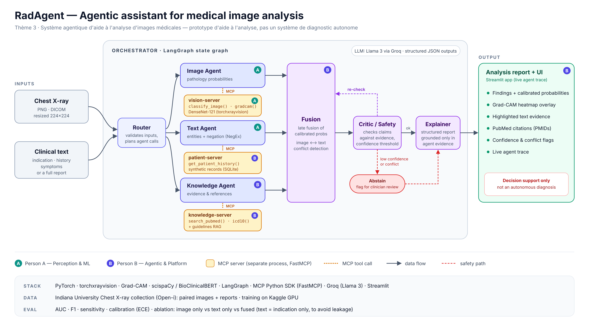

# RadAgent

Agentic decision-support system for chest X-ray analysis (CNN + NLP + MCP). MSc project, Thème 3: *Développement d'un système agentique d'aide à l'analyse d'images médicales*.

> **Aide à l'analyse uniquement — ne constitue pas un diagnostic médical.**
> RadAgent is an experimental prototype, not an autonomous diagnostic system.



## What it does

| Requirement | How RadAgent covers it |
|---|---|
| Analyse a medical image | DenseNet-121 pretrained on chest X-rays (torchxrayvision), calibrated |
| Identify a pathology | Calibrated probabilities for Cardiomegaly, Effusion, Atelectasis, Lung Opacity, Nodule |
| Analyse a medical text | LLM extraction (Groq) with a verbatim check and negation detection |
| Access resources via MCP | 3 MCP servers: `vision-server`, `patient-server`, `knowledge-server` (PubMed, ICD-10, guidelines) |
| Combine the results | Log-odds fusion + image/text conflict detection + critic with abstention |
| Explain the result | Grad-CAM heatmaps, highlighted text evidence, PubMed citations, structured report |

## Repository layout

```
ml/            Person A — models (vision.py, text_nlp.py, labels.py, artifacts/)
eval/          Person A — calibration, evaluation, figures
scripts/       Person A — text cache, gold set, demo-case finder
servers/       Person B — MCP servers (FastMCP)
agents/        Person B — LangGraph state, agents, fusion, critic, explainer
app/           Person B — Streamlit app
data/          splits.csv, preds_image.csv, text_cache.json, icd10.csv, demo/ (no raw dataset in git)
examples/      3 complete valid outputs (agreement, conflict, abstention)
tests/         contract tests
docs/          plan, Person A guide, architecture diagram
contracts.md   the data contract (contracts.py = the same rules, executable)
```

## Data contract

Every JSON exchanged between components is defined in [`contracts.md`](contracts.md) and enforced by [`contracts.py`](contracts.py).

```bash
python -m pytest tests/test_contracts.py -q
RUN_ML_TESTS=1 python -m pytest tests/test_contracts.py -q   # also checks ml/vision.py and ml/text_nlp.py
```

Never change a field alone: agree first, update both files in the same pull request, and bump `CONTRACT_VERSION`.

## Setup

```bash
python -m venv .venv
.venv\Scripts\activate                 # Windows
source .venv/bin/activate              # macOS / Linux
pip install torch torchvision --index-url https://download.pytorch.org/whl/cpu
pip install -r requirements.txt
cp .env.example .env                   # then fill in your Groq key and model names
```

## Run

```bash
python -m servers.warm_cache        # once, online: PubMed cache for the offline demo
streamlit run app/streamlit_app.py  # the app (demo cases in the sidebar)
python -m agents.graph              # the 3 example cases in the terminal, checked against the contract
python -m pytest tests -q           # all tests
```

The report is written by the LLM (Groq) when `GROQ_API_KEY` is set in `.env`, with a deterministic template as fallback. The image agent switches from its stand-in to the real model as soon as `ml/vision.py` exists.

## Team

| Role | Person | Owns |
|---|---|---|
| A — Perception & ML | partner | `ml/`, `eval/`, `scripts/`, A's data files |
| B — Agentic & Platform | [@yacine-svg](https://github.com/yacine-svg) | `agents/`, `servers/`, `app/`, B's data files |

**Rules for both of us and for any AI assistant: [`AGENTS.md`](AGENTS.md).** Cursor loads them automatically (`.cursor/rules/radagent.mdc`); for ChatGPT or Claude chats, upload `AGENTS.md` + `contracts.md` at the start of the conversation.

## Team workflow

- One branch per block (`a2-vision`, `b2-knowledge-server`), merged into `main` through a pull request.
- `main` must always run.
- Never commit `.env`, API keys or the raw dataset.
- Plan and day-by-day schedule: [`docs/RadAgent_2-week_plan.pdf`](docs/RadAgent_2-week_plan.pdf)
- Person A step-by-step guide: [`docs/RadAgent_PersonA_beginner_guide.pdf`](docs/RadAgent_PersonA_beginner_guide.pdf)

## Data

Indiana University Chest X-ray collection (Open-i). Download it on Kaggle (`raddar/chest-xrays-indiana-university`); it is not stored in this repository.
